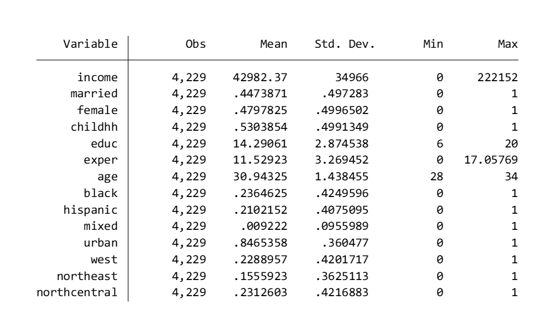
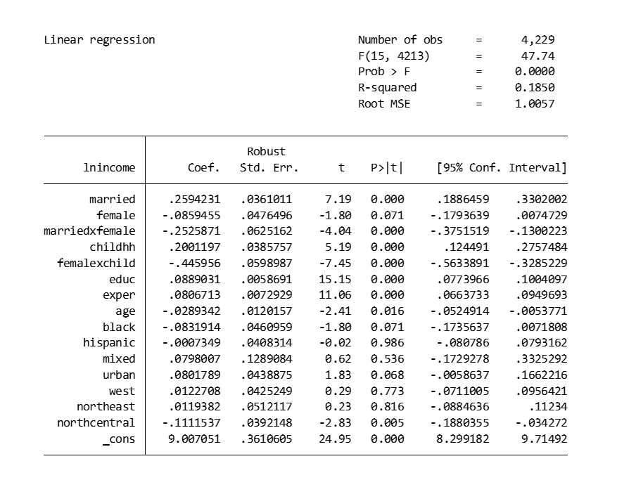

# 💍Marriage and Income Regression Analysis


## 📖Overview

This is a research project that was originally assigned in my Econometrics college course. The purpose of the project was to estimate how an independent variable affects a dependent variable, ceteris paribus, or holding other factors constant. The chosen topic had to be grounded in economic theory to formulate hypotheses, model specification, and assist in explaining the regression results.


## 🎯Research Topic & Theory

### Topic Question:

***What are the effects of marriage on income across genders?***

### Household Specialization and Division of Labor Theory (Becker, 1981)

Marriage can be viewed as a contractual agreement that incentivizes both partners to achieve joint utility maximization within their household. Individuals allocate time and effort to activities based on their comparative advantage in either labor market or household production. Through this specialization and division of labor, households can increase overall efficiency, output, and welfare. 

Historically and traditionally, Becker observed that married men tended to experience a marriage premium while married women experienced a marriage penalty. Although, Becker also noticed the increasing female labor market participation and rise of dual income households leading him to predict the weakening of the traditional female marriage penalty over time.

### Human Capital Theory
Investments of time and effort into education, training and other experiences are said to increase human capital. As a result of increasing human capital accumulation, an individuals earnings should also increase.


## 🧠Hypotheses

### Hypothesis 1: Marriage Premium for Men

| Hypothesis |  Meaning |
| :--- | :--- |
| **H<sub>0</sub>**: β₁ = 0 | Being married has no effect on income for men |
| **H<sub>1</sub>**: β₁ > 0 | Being married has a positive effect on income for men |

### Hypothesis 2: Marriage Premium for Women

| Hypothesis |  Meaning |
| :--- | :--- |
| **H<sub>0</sub>**: β₁ + β₃ = 0 | Being married has no effect on income for women |
| **H<sub>1</sub>**: β₁ + β₃ < 0 | Being married has a negative effect on income for women |

### Hypothesis 3: Gender Difference in the Marriage Effect on Income

| Hypothesis |  Meaning |
| :--- | :--- |
| **H<sub>0</sub>**: β₃ = 0 | Being married has the same effect on income for men and women |
| **H<sub>1</sub>**: β₃ ≠ 0 | Being married has a different effect on income for men and women |


## 🗄️Data & Methodology
### Data: National Longitudinal Survey of Youth 1997 (NLSY97)
* This project utilizes a cross-sectional sample of data collected from the 2013 survey year.
* The 2013 survey year was chosen to examine the relationship between marital status and income at a single point in time where a significant portion of individuals had already married or had just gotten married. 
* This provided substantial variation in marital status while analyzing the relationship between marital status and income holding human capital characteristics and demographics constant. 

### Missing Data and Negative Survey Codes
**Sample number before cleaning: 8,984 respondents**

**Sample number after cleaning: 4,229 respondents**

* Observations containing missing values for any variables were removed from the sample. 
* Negative survey codes used to indicate non-interviews, valid skips, invalid skips, refusals to answer, or "I don't know" were also removed from the sample.
* A substantial amount of respondents were dropped for non-interviews across all variables in the 2013 survey year.

### 🔧Variable Transformation & Construction

*income* → *ln(income)*
* the dependent variable was transformed into using the natural log of income as it allows the coefficient estimates to be interpreted as percentage changes in income

*married*
* originally a categorical marital status variable including married, never married, widowed, separated, and divorced transformed into a binary indicator variable for married or not married

*marriedxfemale*
* interaction term between *married* and *female* to analyze the effect of marriage on income by gender

*childhh*
* originally an aggregated continuous variable representing the total number of children residing in the household transformed into a binary indicator variable for children residing in the household or no children residing in the household

*femalexchild*
* interaction term between *female* and *childhh* to acknowledge the potential parenthood effects on income by gender

*exper*
* generated by aggregating number of weeks worked in any job each survey year from 1997-2013 into one variable then dividing by 52 to convert into years of work experience in any job


## 📐Model Specification 
```text
ln(income) = β₀ + β₁married + β₂female + β₃married×female
           + β₄childhh + β₅female×childhh + β₆educ
           + β₇exper + β₈age + β₉black
           + β₁₀hispanic + β₁₁mixed + β₁₂urban
           + β₁₃west + β₁₄northeast + β₁₅northcentral
```

### Variable Definitions
| Variable | Description|
| :--- | :--- |
| income | total income from wages and salary in 2013 |
| married | 1 = married, 0 = not married |
| female | 1 = female, 0 = male |
| marriedxfemale | interaction term between marriage and female |
| childhh | 1 = children present in the household, 0 = no children present in the household |
| femalexchild | interaction term between female and childhh |
| educ | years of education |
| exper | years of work experience |
| age | age in years |
| black | 1 = black, 0 = not black |
| hispanic | 1 = hispanic, 0 = not hispanic |
| mixed | 1 = mixed, 0 = not mixed |
| urban | 1 = resides in urban area, 0 = resides in rural area |
| west | 1 = resides in western region, 0 = does not reside in the west |
| northeast | 1 = resides in the northeast region, 0 = does not reside in the northeast |
| northcentral | 1 = resides in the north central region, 0 = does not reside in north central |


## 📊 Descriptive Statistics
### Table 1. Descriptive Statistics Table

Table 1 presents summary statistics from Stata for the variables that will be included in the regression.




## 📈 Regression Results
### Table 2. Regression Output Table

Table 2 presents regression results from Stata after running the OLS regression on the specified model.



### Hypothesis 1: Marriage Premium for Men
*married*: β₁ = 0.259
* statistically significant at the 1% level
* reject **H<sub>0</sub>** because the estimated coefficient (β₁ = 0.259) was positive and statistically significant
* evidence supports a marriage premium for men

### Hypothesis 2: Marriage Premium for Women
| *married*: β₁ = 0.259 | *marriedxfemale*: β₃ = -0.253 | β₁ + β₃ = 0.006 |
| :--- | :--- | :--- |
* both estimated coefficients were statistically significant at the 1% level
* fail to reject **H<sub>0</sub>** because the estimated coefficient (β₁ + β₃ = 0.006) was not negative
* does not support alternative hypothesis that marriage results in lower income for women
* evidence supports a tiny marriage premium for women

### Hypothesis 3: Gender Difference in the Marriage Effect on Income
*marriedxfemale*: β₃ = -0.253
* statistically significant at the 1% level
* reject **H<sub>0</sub>** because the estimated coefficient (β₃ = -0.253) was negative and statistically significant
* evidence supports that income effects from being married differ across gender


## 💡 Findings & Discussion
### Key Findings
| Findings | Connection to Theory |
| :--- | :--- |
| Married men earned an income 26% higher than unmarried men, all else equal. This finding supports a significant positive marriage premium for men. | The results are consistent with Becker's Household Specialization and Division of Labor Theory, which predicts that household specialization, particularly specializing in labor market work, may contribute to the observed positive labor market outcome for married men in this sample. |
| Married women experienced an income 0.6% higher than unmarried women, all else equal. Though the size of the higher income is not economically significant it is still positive. This finding suggests that marriage was not associated with lower income for women in this sample. | The near zero marriage premium for women may indicate moving away from the theory of complete specialization and towards partial specialization within households as Becker noticed female labor market participation increased and dual income households became more common.
| Married women experience a 25.3% lower income effect relative to the income effect married men experience, all else equal. This finding shows a significant gender disparity in how marriage affects income. | Household specialization for married couples creates a division of labor resulting in different earnings outcomes. |


### Presence of Children in the Household
In this sample, men with at least one child in the household experienced a 20% higher income compared to men without any children in the household whereas women with at least one child in the household experienced 24.6% lower income relative to women without any children in the household, all else equal. The estimated income effect of having at least one child in the household was 44.6% lower for women relative to the income effect for men, all else equal. Based on these findings, it may indicate that the persistent gender disparity of income within this sample may be associated with parenthood effects on income. 


### Human Capital
In this sample, every additional year of education was associated with a 9% increase in income and every additional year of work experience was associated with an 8% increase in income, all else equal. This is consistent with human capital theory in that investing time and effort into things like education and work experiences may yield higher earnings as observed in this sample. 


## 🏁 Conclusion
This project examined the relationship between marital status and income across genders using a cross-sectional sample from the 2013 NLSY97 survey year. The results indicate a significant male marriage premium while there was an estimated marriage premium for women, it wasn't economically meaningful. Additionally, the effects of marriage on income differed across genders.

The other findings further suggest that the presence of children in the household may play an important role in the income differences between men and women in this sample. Women with at least one child in the household experienced substantially lower income effects relative to the income effects men with at least one child in the household experienced. The presence of children in the household may change incentives for household specialization, as their needs might increase the value of household production potentially resulting in a shift towards complete specialization.

Despite the significant results and findings, there are limitations that come with this project such as only choosing one survey year to analyze and unobserved factors or characteristics. Although there are many limitations, the analysis of this sample provided potentially meaningful insight into how marriage, presence of children in households, and human capital are associated with income. 
